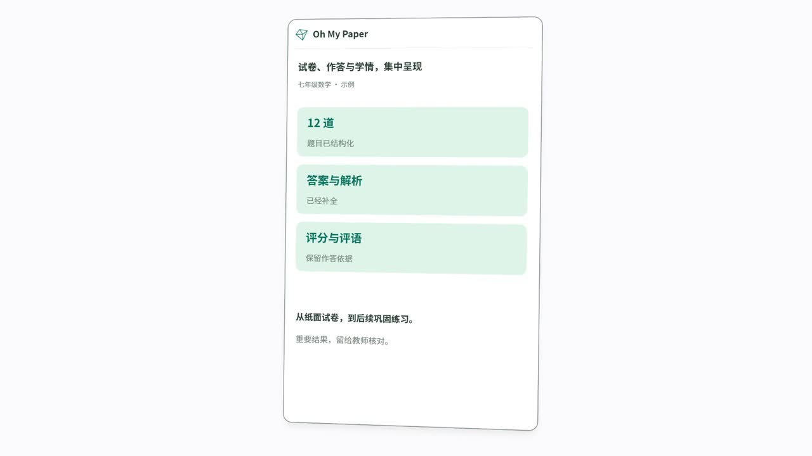

# Oh My Paper · 把时间还给教学

**从一张纸，到一次有反馈的学习。**

Oh My Paper 是面向 K12 教师、学生和学校的开源教学平台。把手里的试卷和作业变成可复用的题库，完成组卷、答题卡制作、作答收集、人工或 AI 批改，再把每次练习转化为成绩、错题与学习反馈。

你可以在自己的服务器上运行整个平台，为学校或教研团队建立独立的教学工作空间。

[观看宣传片](docs/media/oh-my-paper-features.mp4) · [部署你的网站](docs/deployment.zh-CN.md) · [第一次使用](docs/getting-started.zh-CN.md) · [MIT 许可证](LICENSE)

## 82 秒，看看它能做什么

[](docs/media/oh-my-paper-features.mp4)

点击封面打开宣传片；也可以[下载 MP4](docs/media/oh-my-paper-features.mp4?raw=true) 观看。演示画面仅用于展示功能，实际效果取决于材料质量、模型与人工核验。

## 从备课到讲评，在一个地方完成

| 你要完成的事         | Oh My Paper 如何帮你                                                              |
| -------------------- | --------------------------------------------------------------------------------- |
| 让旧试卷重新派上用场 | 上传图片或 PDF，AI 辅助识别题目、配图、答案和知识点，整理成可编辑、可复用的题库。 |
| 更快准备作业与考试   | 从题库选题或让 AI 协助组卷，调整题序、分值和版面，制作练习册与答题卡。            |
| 收齐纸面与线上作答   | 上传扫描件、接入兼容扫描仪，或布置线上作业，集中查看学生提交。                    |
| 减少重复批改         | 人工阅卷与 AI 辅助评分结合，查看逐题反馈；考试支持双评与仲裁。                    |
| 让讲评更有针对性     | 查看成绩、知识点表现和错题，为学生生成错题复现卷与 AI 巩固卷。                    |
| 管好学校的教学协作   | 统一管理账号、班级、任教关系、校历和课表，按学校、年级、班级与学科分配数据权限。  |

试卷和练习册可导出 Word，也可在浏览器中打印或保存为 PDF；答题卡支持 SVG 下载。

## 直接告诉「小纸」你的教学目标

小纸是平台内的 AI 助手。你可以上传材料、提出目标，并在处理过程中补充要求：

> “把这份数学试卷整理进题库，补充参考答案和知识点。”
>
> “根据这位学生的错题，帮我准备一份巩固练习。”
>
> “帮我查看这次考试的情况，整理讲评重点。”

小纸会按任务需要查找信息、使用平台功能，并给出可继续查看或编辑的结果。它沿用当前账号的权限，处理过程可以查看，也可以停止。AI 识别、答案和评分需要教师核验，正式成绩由有权限的教师确认和发布。

[了解小纸](docs/xiaozhi.zh-CN.md) · [了解 AI 教学助手](docs/agent-tools.zh-CN.md) · [了解错题与巩固练习](docs/revision-papers.zh-CN.md)

## 为教师、学生和学校各留一个合适的工作台

- **教师**：备课、管理题库、布置作业、组织考试、阅卷与讲评，减少在多个工具之间搬运材料。
- **学生**：完成线上作业与练习，查看本人已发布的成绩、错题和学习反馈。
- **学校与教研团队**：集中管理教学账号与班级，让不同岗位在各自权限范围内协作。

## 部署你自己的 Oh My Paper

推荐使用 **Linux 服务器 + Docker Compose**。准备一个指向服务器的域名，开放 80、443 端口，安装 Git、Docker Engine、Compose、Buildx 和 Python 3。AI 功能需要你自行接入模型服务，可能产生供应商费用。

```bash
git clone --branch v2 https://github.com/TaiRuiQu/oh-my-paper.git
cd oh-my-paper
cp .env.example .env
mkdir -p storage tmp
sudo chown 1000:1000 storage tmp
```

按[部署指南](docs/deployment.zh-CN.md#全新服务器部署)填写域名、数据库密码和随机密钥，然后启动：

```bash
sudo docker compose -f compose.yaml up -d --build
sudo docker compose -f compose.yaml ps -a
```

打开你配置的网站地址。首次启动会自动创建管理员，初始账号和随机密码仅在服务端日志中输出一次。登录后先创建教师、班级和学生，再到「系统管理 → AI 模型配置」接入模型。

部署指南还提供发布镜像安装、更新、备份与常见问题处理。首次构建需要下载运行组件并编译应用，耗时和资源占用取决于服务器配置。

## 继续了解

- [第一次使用：从建班到第一次讲评](docs/getting-started.zh-CN.md)
- [部署、更新与备份](docs/deployment.zh-CN.md)
- [小纸使用指南](docs/xiaozhi.zh-CN.md)
- [AI 能帮你做什么](docs/agent-tools.zh-CN.md)
- [AI 费用怎么看](docs/ai-cost.zh-CN.md)
- [任务进度与失败重试](docs/ai-progress.zh-CN.md)
- [错题复习与巩固卷](docs/revision-papers.zh-CN.md)
- [接入扫描仪](scripts/scanner-bridge/README.md)

## 开源与许可

项目原创代码采用 [MIT License](LICENSE)，允许使用、修改和商业部署。第三方依赖、字体与内置第三方技能继续遵循各自许可证，见[第三方声明与兼容性审查](THIRD_PARTY_NOTICES.md)。

项目仍在持续迭代，欢迎通过 [Issues](https://github.com/TaiRuiQu/oh-my-paper/issues) 反馈使用体验、提出建议或报告问题。请使用虚构材料复现问题，避免上传学生个人信息、真实答卷或访问密钥。
