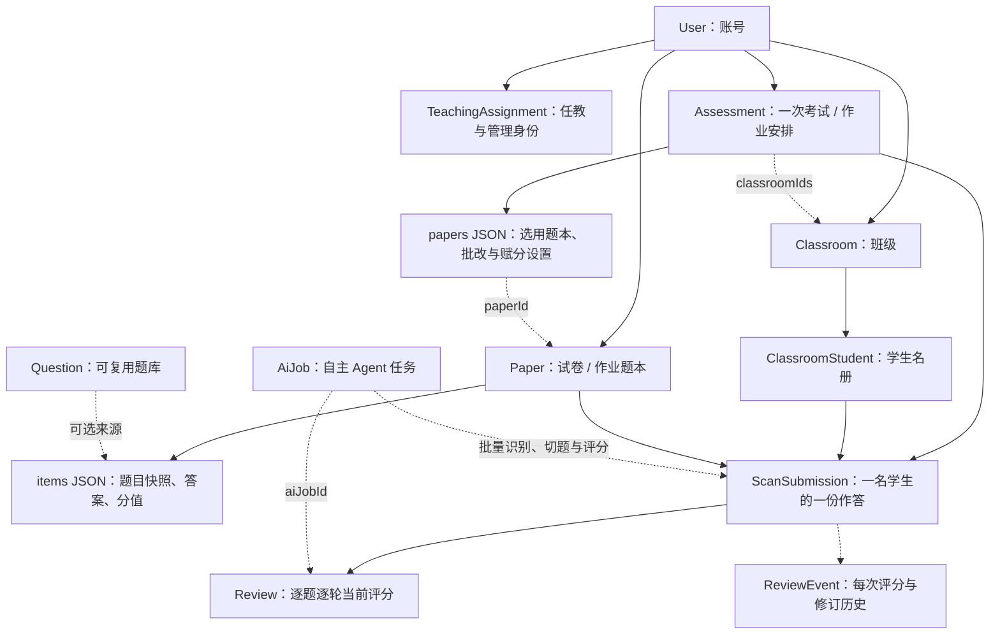

# 数据模型关系说明

当前实现将题目内容和批改规则直接内嵌保存，减少中间关联。以下按班级批量批改重构后的结构说明；以 `prisma/schema.prisma` 和共享类型为准。

## 核心结构



图中实线用于表达直接归属或外键，JSON 子对象不代表独立表；虚线表示 ID、数组、来源或业务引用。准确的外键及删除规则以 schema 的 `@relation` 为准。

**PaperItem、AssessmentPaper 现在只是 TypeScript 数据类型，不再是数据库模型。** 迁移把原表内容转入 Paper.items、Assessment.papers，再删除两张中间表。Assessment.studentIds 同时删除，参与范围由班级决定。

## 全部数据库模型

| 模块   | 模型                | 用途和主要关联                                                          |
| ------ | ------------------- | ----------------------------------------------------------------------- |
| 账号   | User                | 用户、基础角色和资源所有者                                              |
| 认证   | Session             | userId 外键关联 User；用户删除时级联                                    |
| 认证   | Account             | userId 外键关联 User；存密码或身份提供方凭据                            |
| 认证   | Verification        | 验证凭据与有效期；没有 User 外键                                        |
| 班级   | Classroom           | ownerId 外键关联 User；保存班名和年级                                   |
| 班级   | ClassroomStudent    | classroomId 外键关联 Classroom，userId 可选关联 User                    |
| 权限   | TeachingAssignment  | userId 关联 User；classroomId 可选关联班级，另存年级、学科、教学身份    |
| 内容   | Question            | ownerId 关联 User；content 保存题目、答案、小问、解析、配图             |
| 内容   | Paper               | ownerId 关联 User；items JSON 保存卷内题目快照，layout JSON 保存版式    |
| 安排   | Assessment          | ownerId 关联 User；classroomIds 保存参与班级，papers JSON 保存题本配置  |
| 答题卡 | CardTemplate        | ownerId、paperId 均为可选外键；layout 保存定位点、学号区及题区          |
| 作答   | ScanSubmission      | ownerId、assessmentId、paperId、studentId 为外键；templateId 可选       |
| 评分   | Review              | submissionId、reviewerId 为外键；itemId 和 aiJobId 为逻辑引用           |
| 历史   | ReviewEvent         | 保存每次评分提交的不可变快照；各身份字段无外键                          |
| 资产   | PlatformAsset       | 保存文件 path、类型和 ownerId；ownerId 无外键                           |
| AI     | AiProvider          | 供应商接口、密钥、输出、超时与并发配置                                  |
| AI     | AiModel             | providerId 外键关联 AiProvider；供应商内模型名唯一                      |
| AI     | AiSetting           | modelId 可选关联 AiModel；保存模型偏好                                  |
| AI     | AiJob               | 任务队列，input/result/events JSON；userId、modelId 无外键              |
| 检索   | EmbeddingSetting    | 独立保存题库向量化接口、模型、维度和版本                                |
| 检索   | QuestionSearchIndex | 题目索引同步状态；questionId/version 无外键，删除标记可在题目删除后保留 |

## 题库、题本和安排

- Question 是可复用题库资源。Paper.kind 为 EXAM 或 HOMEWORK。
- Paper.items 每项是 `{id,questionId,position,score,section,snapshot}`；snapshot 是完整 BankQuestion，包含标准答案、解析、评分标准及混合小问。
- questionId 表示题目来源及版面定位标识，可以对应题库，也可以是卷内新建题目。修改题库不会改变已保存的卷内快照。
- Paper.items[].id 是实际作答、评分、逐题规则、答题卡题区引用的标识；混合题小问使用 snapshot.content.parts[].id。
- Assessment.kind 同样为 EXAM 或 HOMEWORK，代表一次具体考试或作业布置。
- Assessment.papers 每项是 `{paperId,subject,gradingMode,arbitrationThreshold,questionRules,conversion}`。配置内每个学科只能选一份题本；同一 Paper 可以被多个 Assessment 复用。
- Assessment 不配置学生 ID 名单，只保存 classroomIds。参与学生来自当前班级名册；新加入班级的学生也属于参与范围。已有作答的学生不能随意更改身份或删除。
- 安排中的 paperId 是 JSON 引用，由领域命令校验，不再依赖中间表外键。题本已被安排使用后仍不能直接编辑内容或删除，需要另存新版；重命名可独立执行。
- published 表示成绩已发布，不代表作业是否已布置。学生只能查看本人已发布的结果。

## 账号、名册与教学权限

User.role 为 ADMIN、TEACHER、STUDENT。学生账号与班级名册分开：同一账号可关联多个班级名册；名册可以暂不绑定账号。作答的 studentId 始终对应 ClassroomStudent.id。

| TeachingAssignment.role | 范围                               |
| ----------------------- | ---------------------------------- |
| SCHOOL_ADMIN            | 全校教学数据                       |
| GRADE_DIRECTOR          | grade 指定年级                     |
| HOMEROOM                | classroomId 指定班级全部学科       |
| SUBJECT_TEACHER         | classroomId + subject 指定任教学科 |

管理查看权限与批改权限分别校验。普通教师批改取决于任教学科；Assessment.reviewScope=CLASSROOM 仅本班任课教师，GRADE 允许同年级任课教师按学科跨班评阅。作业只允许 CLASSROOM。管理员拥有全系统权限。权限每次从数据库读取，客户端不能伪造角色、ownerId、reviewerId。

## 作答和评分

ScanSubmission 唯一键为 `(assessmentId,paperId,studentId)`，保存 sourceFiles、answers、alignment。answers 每项包含 itemId、text、images、可选 box/sourcePage。ownerId 是录入者，studentId 才是学生归属。

Review 唯一键为 `(submissionId,itemId,round)`。round 为 FIRST、SECOND、ARBITRATION；source 为 HUMAN 或 AI。AI 评分记录发起人的 reviewerId，并保存 aiJobId。ReviewEvent 追加保存每次提交及修改，不通过 reviewId 连接当前记录，而通过作答、题目、轮次对应。

- 单评采用首评，AI 首评可直接形成最终分。
- 双评 AI 首评作为建议，须教师确认，再由另一名教师独立第二评；正常双评取均分。
- 开启仲裁且分差超过阈值，由第三名教师仲裁；最终采用仲裁分与较近原评分的均分，等距时以原两评分均值作为另一参与值。
- 混合题逐问分数保存在 Review.partScores，使用 partId 对应题目快照小问。
- 已有评分的作答不能替换，AI 不能覆盖已有评分；已发布成绩需先撤回才能继续批改。

## AI 班级批量批改

`BATCH_GRADE` 输入：

```ts
{
  assessmentId: string;
  classroomId: string;
  paperId: string;
  assetUrls: string[]; // 默认 []，最多 100 页、150 MB
  studentHints: { sourceUrl: string; studentId: string }[]; // 默认 []
}
```

教师选择安排、班级、题本并上传全班图片或多页 PDF。无需逐个选择学生、无需人工逐题框选。未上传材料时，批量评阅该班已录入且没有评分的作答。

Agent 自主决定查看哪些图片、如何分组、何时切题与评分，工具负责校验，不采用固定模型工作流：

| 工具                | 作用                                                   |
| ------------------- | ------------------------------------------------------ |
| read_classroom      | 读取真实名册、题本、答案和待批改作答                   |
| python / shell      | 查看原始页和作答图，按需处理材料                       |
| register_submission | 根据可见姓名或考号唯一匹配学生，合并多页               |
| record_answers      | 自动定位题目区域，生成作答裁剪图，支持跨页             |
| propose_grade       | 按学生和题目批量提交首评分数及评语                     |
| defer_pages         | 记录无法确认学生的页，继续其他作业                     |
| skip_questions      | 记录无法辨认或缺失的题，保留未评分状态                 |
| finish              | 校验页面与题目覆盖，原子提交作答、评分、历史和任务结果 |

同名、考号矛盾、缺少身份的材料不能按上传顺序猜测学生。result.pendingPages 保存原图与原因；教师在任务结果中确认学生后，用 studentHints 重新提交这些页面。已确认学生但看不清作答的题保存在 result.skipped，供人工核对。未上传的学生不会生成虚假作答或零分。

任务结果还保存 students 列表，包含姓名、submissionId、已评分和待核对题数。AI 任务通过 AiJob 队列后台执行，离开页面仍继续。提交时再次验证权限、题目、批改配置、学生身份、作答和已有评分，防止覆盖处理期间的人工修改。失败提交回滚业务数据并清理新裁剪图。

## 自主任务与配置

AiProvider 一对多 AiModel；AiModel 一对多可选 AiSetting。任务直接传 modelId，当前执行路径不通过 AiSetting 选模型。AiJob 通过 kind 和 input 引用业务目标；模型删除不会级联删除历史任务。

现有任务包括 IMPORT（导入）、ENRICH（答案与知识点）、ASSEMBLE（真实题库组卷）、TEMPLATE（答题卡）、GRADE（单份已录入作答）、BATCH_GRADE（班级批量批改）、RECOMMEND（真实题库推题）。其他功能新增任务以 `src/contracts/platform-ai.ts` 为准。

EmbeddingSetting 独立配置向量化服务。QuestionSearchIndex 保存当前 version/revision/indexedRevision 及同步状态，Worker 将向量写入 Qdrant；不设 Question 外键是为了在原题删除后保留外部索引清理标记。

## 文件与 JSON 引用

PlatformAsset 保存图片文件元信息，业务字段通过 `/api/platform/assets/{id}` 引用。常见引用位置：题目 images、卷内快照 images、作答 sourceFiles、answers[].images/sourcePage、答题卡 regions[].image、AI input.assetUrls。PDF 在材料入口按页转换为私有图片。业务命令和读取接口检查权限，文件路径不会直接由客户端注入。

版面 questionLayouts 使用 questionId；作答与评分使用 itemId；小问评分使用 partId。这三个标识层级不同。

## 派生数据与数据库保护

总分、排名、错题、知识点掌握和 LearningReport 均由 analytics.ts 计算，没有对应独立数据库表。错题保存于返回结构，包含原卷题目快照、实际作答、分值、评语和失分小问 ID。AI 推荐结果另存任务 result。

主要唯一约束：User.email/username、Session.token、Account 的 providerId/accountId、AiModel 的 providerId/name、ClassroomStudent 的 classroomId/studentNumber 和 classroomId/userId、ScanSubmission 的三元唯一键、Review 的三元唯一键、QuestionSearchIndex.questionId。题项 ID、题序和安排学科等 JSON 内约束由领域代码维护。

外键删除行为：认证、题库、题本、班级、安排、教学身份等多数归属关系 Cascade；学生绑定账号、作答模板、模型偏好为 SetNull；作答引用题本/学生、评分引用评分人为 Restrict。应用层对已使用题本、模板、作答、学生和已发布安排另有更严格的保护。

## 代码入口

- `prisma/schema.prisma`：数据库模型。
- `prisma/migrations/20261019000000_class_batch_grading/migration.sql`：中间表到 JSON 的迁移。
- `src/contracts/platform.ts`、`platform-ai.ts`：共享 JSON 结构与任务输入。
- `src/server/platform/records.ts`：数据库 JSON 集合映射。
- `src/server/platform/commands/`：业务写入、约束与权限。
- `src/server/platform/ai/batch-grading.ts`：自主班级批改工具及原子提交。
- `src/server/platform/analytics.ts`、`queries.ts`：成绩、错题、学情和权限投影。
- `src/lib/student-identity.ts`：练习册首页姓名、班级、六位考号填写与填涂区，供预览、打印及 Word 共享。
