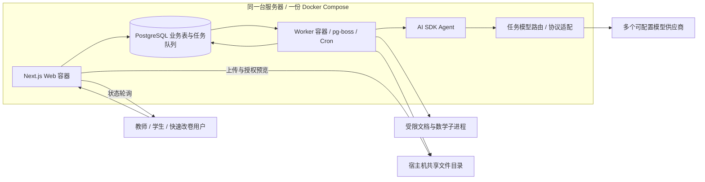

**K12 试卷解析、批改与错题练习：技术选型及分步执行计划**

制定日期：2026-10-11。现已建立依赖清单、初始化 Web/Worker、认证与工作空间数据库迁移，并验证基础设施任务消费和重试。试题数据准备中，尚未实现 AI/评分业务或调用真实模型；本次工程范围见 [工程底座说明](./framework.zh-CN.md)。当前 Ubuntu 环境使用本机已有 Node.js 24 / pnpm 11；依赖安装历史见 [当前电脑依赖安装记录](./local-dependencies.zh-CN.md)。

已经明确的需求：使用 Next.js 构建全栈网站；服务国内教师、学生及其他快速改卷使用者；首版支持 PDF、JPG/JPEG 和 PNG 图片，用户将 Word 导出或打印为 PDF 后上传；每个 AI 业务步骤是一轮可使用工具、多次模型调用的 Agent 任务；后台允许配置多个模型供应商，每个供应商有独立 API Base URL 和 API Key；可以接入国外模型。

文件范围适用于试卷录入、参考答案上传、作答上传和快速改卷全部入口。首版不接收 .doc/.docx，不实现 Word 转换链路；上传说明统一提示“支持 PDF、JPG、PNG；Word 文档请先导出或打印为 PDF”。

环境与存储约束：本地开发不使用 Docker，直接运行 Next.js、Worker 和本机 PostgreSQL；部署环境使用 Docker Compose，把 Web、Worker、PostgreSQL 和反向代理统一部署在同一台服务器。首版本地开发和部署均采用本地文件系统，不使用 S3、OSS 或其他对象存储；pg-boss 复用 PostgreSQL，首版不引入 Redis 或 BullMQ。

用于估算的假设：小团队、先实现响应式网页，首个质量验证范围为中文初中数学。首版保留所有文件入口、教师和学生身份及两条批改路径；其他学科通过相同架构逐步加入，并分别评测。这个验证范围是建议，不是已确认的用户限制。

**1. 推荐架构与技术栈**

采用模块化单体代码库，包含 Web 和 Worker 两个运行入口。当前本地开发环境为 Ubuntu，工程初始化后直接运行两个进程，并连接项目本地 PostgreSQL；部署时由 Docker Compose 统一运行。Next.js 负责页面、登录、API、文件上传与任务提交；Worker 消费 pg-boss 队列，执行 PDF/图片标准化、Agent 管线和定时调度；PostgreSQL 保存业务数据和持久化任务，本地磁盘保存上传原件和处理结果。Web 与 Worker 共享同一存储根目录；PDF 渲染通过受限子进程执行。

| 层次 | 选型 | 用途及决策理由 |
| --- | --- | --- |
| 全栈应用 | Next.js 16.x、App Router、React、TypeScript | 页面和业务 API 统一开发；长任务提交后返回任务 ID |
| 运行环境 | Node.js 24 LTS、pnpm 11.x | 使用本机现有版本，部署镜像使用同一 Node 主版本；Web/Worker 共享服务端模块 |
| UI | Tailwind CSS、shadcn/ui | 响应式工作台、文件上传、表格、对话框、审核界面 |
| 客户端数据 | TanStack Query、React Hook Form、Zod | 任务轮询、筛选、表单与数据验证 |
| 公式与试卷预览 | MathJax、PDF.js | LaTeX 公式和原始 PDF 对照；保存结构化内容而非仅保存截图 |
| 数据库与 ORM | PostgreSQL 18、Prisma 7.x、pg 驱动适配 | 本地原生 PostgreSQL，部署 PostgreSQL 容器；关系数据与 JSONB |
| 文件存储 | Node.js 文件系统、本地存储模块 | 原件、页图、题图和导出文件保存到 STORAGE_ROOT；首版只实现本地存储 |
| 登录 | Better Auth | 登录、会话；应用业务权限单独实现，不能仅靠前端菜单 |
| 后台任务与定时调度 | pg-boss、PostgreSQL、独立 Worker | 本地 Node.js 进程，部署 Worker 容器；持久化、重试、并发控制及 Cron |
| Agent | AI SDK 7.x、ToolLoopAgent、Zod 输出 Schema | 模型供应商适配、多步工具调用、类型化输出；每个业务阶段独立执行 |
| 文件标准化 | Poppler、Sharp | PDF 渲染与文本辅助提取、图片缩放和裁剪 |
| 数学及图像辅助 | 受限 Python 工具：SymPy、按需 OpenCV | 公式等价和求值、单位与范围检查、复杂倾斜/透视校正；不是另建一套 Web 后端 |
| 测试 | Vitest、Playwright、固定 AI 评测集 | 评分规则、权限、恢复流程及用户端到端流程 |
| 部署 | Docker Compose、单台国内云服务器 | Web/Worker/数据库/反向代理统一部署；文件目录挂载到服务器磁盘持久化 |
| 监测 | 结构化日志、OpenTelemetry、错误监测 | 任务耗时、模型调用、token、失败率和单位成本；学生内容及密钥脱敏 |

当前已安装 Next.js 16.4.0、AI SDK 7.0.137；全部直接依赖以确切版本写入 package.json，完整依赖树由 pnpm-lock.yaml 锁定。工程初始化沿用现有清单；升级时重新核对安全更新和兼容性。

Prisma CLI、Client 和 PostgreSQL 适配器统一锁定到同一 7.x 版本，当前已安装的配套版本为 7.10.0；不用不同大版本的 CLI/Client 混装。当前本机 Node.js 24.19.0 和 pnpm 11.21.0 已通过依赖检查，部署镜像使用同一 Node 主版本与项目固定的 pnpm 版本。新镜像和本机后续补丁更新分别测试。

Next.js 官方支持 Node.js/Docker 自托管。Docker Compose 仅作为部署方式，本地开发及本地数据库安装不依赖 Docker。生产环境使用持续运行的容器；Worker 不需要另一台服务器或另一套部署流程。[Next.js 自托管文档](https://nextjs.org/docs/app/guides/self-hosting)、[Docker Compose 用途](https://docs.docker.com/compose/intro/features-uses/)

Next.js 自带 after()，可在响应结束后执行回调，但不是持久化队列或 Cron 调度器，执行时间仍受部署平台限制。Vercel Cron 是部署平台的功能，通过 HTTP 请求触发应用接口，失败调用不自动重试。试卷上传触发的是即时异步任务；每日统计、复习任务和文件清理才属于定时任务。[Next.js after](https://nextjs.org/docs/app/api-reference/functions/after)、[Vercel Cron](https://vercel.com/docs/cron-jobs/manage-cron-jobs)

pg-boss 是 Node.js 库，复用 PostgreSQL 提供任务持久化、重试、并发策略和定时调度。Web 通过共享任务模块入队；独立 Worker 入口初始化任务消费者和 Cron 调度，任务消费不依赖 Next.js 的 instrumentation 或请求生命周期。Web 构建及页面热更新均不启动消费者。[pg-boss 官方文档](https://pgboss.io/)

首版任务并发建议从 1–2 开始评测；密集 PDF 渲染单独限制并发并用子进程执行。本地开发中 Web 和 Worker 为两个进程；部署中为两个容器，可分别限制资源和重启。Worker 退出时停止领取新任务，给已运行任务有限的收尾时间；中断任务依据队列超时、重试规则和业务检查点恢复。所有 Worker 停止期间没有任务执行，定时统计根据最后成功时间补算。

本地依赖准备已完成：使用本机 Node 24.19.0、pnpm 11.21.0 和 Python 3.14.4；PostgreSQL 18.6 安装到 .tools/postgresql，数据位于 .local/postgresql/data，通过 pnpm run db:start/db:stop/db:status 管理，不依赖系统服务。Poppler 和中文字体使用现有系统安装，SymPy 安装到 .venv。已提供 pnpm run doctor、scripts/env.sh 和 .env.example；本机 .env 保存项目数据库连接串及随机密钥。安装结果和使用方法见 [本地开发说明](./development-setup.zh-CN.md)。

工程初始化阶段继续提供 pnpm run dev、pnpm run dev:worker、pnpm run dev:all 三个应用启动脚本。Worker 显式加载与 Web 对应的开发环境变量，子进程可执行文件使用可配置路径。使用 shell:false 的参数数组调用 PDF 工具，并保留 Windows 空格路径兼容性。pnpm 11 自带 doctor 命令，执行项目检查时必须使用 pnpm run doctor。

部署交付包括 Dockerfile 的 Web/Worker 构建目标、compose.yaml、健康检查、一次性迁移入口、文件挂载和操作说明。Web/Worker 镜像使用 Node 24，构建使用 pnpm 11.21.0 和现有锁文件。Worker 镜像封装 Poppler、所需字体和受限 Python 工具；Web 镜像只保留网页运行依赖。部署服务器只需要 Docker Engine 与 Compose 插件，依赖由镜像管理；开发机的 .tools、.local 和 .venv 不直接复制到镜像。首次配置后通过 docker compose up -d --build 启动，发布镜像后可通过 docker compose pull 和 docker compose up -d 更新。

Compose 服务依赖使用数据库健康检查和一次性迁移完成条件，应用连接保留有限重试。重启策略处理进程退出，健康检查用于监测。PostgreSQL 使用持久化卷；上传与处理结果保存到宿主机目录，并以相同容器路径挂载给 Web/Worker。数据库端口不公开，页面入口通过反向代理提供 HTTPS。域名、模型供应商、备份和密钥需要实际配置。[Compose 启动顺序](https://docs.docker.com/compose/how-tos/startup-order/)

本地存储约定：本地开发 STORAGE_ROOT=./storage，统一相对项目根目录解析；生产 STORAGE_ROOT=/data/storage，Web 与 Worker 均挂载宿主机 /srv/oh-my-paper/storage 到 /data/storage，并预先设置一致的读写权限。数据库只存相对文件 key、MIME、大小和 hash，不存本机绝对路径。原件、页图、题图和导出文件按工作空间及随机 ID 分目录；临时文件另用 TEMP_ROOT。storage、临时目录、虚拟环境、运行日志及密钥配置加入 Git/Docker 构建忽略规则，容器更新不会把用户文件打入镜像。[Docker 文件挂载](https://docs.docker.com/engine/storage/bind-mounts/)

上传通过有身份校验的 Next.js Node Route Handler，流式写入临时文件，限制大小并校验真实 MIME/hash，完成后在同一文件系统内原子移动并登记 ready 状态，再入队。数据库和文件系统不是同一事务；保留 uploading/ready/failed 状态并定时清理中断上传及无引用文件。预览和下载通过按 assetId 授权的接口，支持 PDF 所需 Range；学生文件不放 public 目录，不接受客户端提供磁盘路径。此方案不需要对象存储签名上传或公共文件 URL。

VLM 无法读取本机或容器路径：Worker 读取题目图像字节，由协议适配器编码为模型支持的图片输入；需要原生文件上传的供应商单独适配，并记录提供者侧文件引用及清理状态。能力测试包含内联图片支持，不通过的模型不能被路由到对应视觉任务。

备份同时覆盖 PostgreSQL、用户文件目录和恢复所需的密钥；按备份批次保存引用清单并验证恢复后文件可读。持久化挂载不能代替备份。首版按单机部署设计，未来扩到多台服务器时再实现共享或对象存储模块。

AI SDK 的 ToolLoopAgent 支持多步工具调用；本项目优先使用它的供应商适配和结构化输出能力。Pi 的核心运行时也可实现工具调用和状态管理；若团队已有成熟 Pi 基础设施，可以替换 src/server/ai 内的运行时。本方案首版只实现 AI SDK，避免同时维护两个 Agent 栈。[ToolLoopAgent](https://ai-sdk.dev/docs/reference/ai-sdk-core/tool-loop-agent)、[Pi Agent 核心文档](https://github.com/earendil-works/pi/blob/main/packages/agent/README.md)

普通 ToolLoopAgent 在内存中执行，不自带进程崩溃后的持久化恢复。AI SDK 另有 WorkflowAgent 提供持久化工作流集成，但本方案选择 pg-boss 配合数据库检查点，复用数据库并由 Compose 管理 Worker。队列的数据库事务也不能保证外部模型调用只发生一次，业务写入仍需要幂等。[WorkflowAgent](https://ai-sdk.dev/docs/agents/workflow-agent)、[pg-boss](https://pgboss.io/)

第一版以 PostgreSQL 结构化筛选完成错题和知识点查询；语义检索确有需求后再增加 pgvector。先不引入独立向量数据库、知识图谱数据库、微服务或通用自治 Agent 平台。



**2. 通用模型供应商配置**

分成供应商、模型、任务路由三层。供应商代表一个具体端点及凭据，同一品牌可以配置多个供应商记录；模型属于某个供应商；不同任务通过路由选择模型。业务 Agent 不写死品牌、地址、API Key 或模型 ID。

| 配置对象 | 主要字段 |
| --- | --- |
| ModelProvider | id、名称、协议类型、apiBaseUrl、credentialVersionRef、可选 headers/queryParams、启用状态、超时、区域和配置版本 |
| ProviderCredential | 供应商关联、加密后的 API Key、凭据版本、密钥版本、轮换和停用状态 |
| ProviderModel | providerId、modelId、显示名、视觉/多图/工具/结构化输出/流式能力、上下文和输出限制、供应商参数、能力测试时间 |
| TaskModelPolicy | taskType、主模型、备用模型列表、复核模型、最大 Agent 步数、时间/token/费用上限、输入区域策略、配置版本 |
| ProviderQuota | 供应商与模型的并发、RPM/TPM、每日预算；组织或用户的业务配额 |

首版供应商模块支持 OpenAI Chat Completions 兼容协议、OpenAI Responses、Anthropic、Gemini 四种协议；开发时先打通兼容协议和 Responses，再在同一阶段补齐后两种适配。OpenAI 兼容供应商可以配置任意符合协议的 endpoint；原生协议通过各自 SDK 适配，不能假设只修改 base URL 就可通用。

实现使用 @ai-sdk/openai-compatible、@ai-sdk/openai，以及按需加入 @ai-sdk/anthropic、@ai-sdk/google。兼容适配器支持自定义 baseURL、apiKey 和参数；文件、图片和结构化输出的真实能力仍取决于目标服务及模型。[OpenAI 兼容供应商文档](https://ai-sdk.dev/providers/openai-compatible-providers)、[OpenAI Provider](https://ai-sdk.dev/providers/ai-sdk-providers/openai)

管理后台需要支持新增、修改、停用供应商，替换密钥，维护模型列表，设置任务路由，查看测试结果和调用统计。配置模型可手工录入；只有供应商支持模型列表接口时才提供自动发现，不把 /models 接口作为必要条件。

“测试连接”分为文本、多模态、工具调用和结构化输出测试，使用固定非敏感样例。记录每项是否实际通过，而非只有 HTTP 200 就宣告可执行所有 Agent。参数采用适配器允许列表和供应商扩展配置，避免强制传入模型不支持的 temperature、reasoning 或 JSON Schema 选项。

模型路由建议定义 parse_paper、parse_answer_key、extract_submission、solve_question、verify_answer、grade_question、tag_knowledge、generate_practice 八类任务。视觉任务必须选通过图片输入测试的模型；Agent 工具任务必须具备工具调用能力。缺少能力时在保存路由或提交任务时给出明确错误。

凭据仅由服务端读取：使用 KMS 或应用主密钥进行带认证的加密，主密钥保存在服务环境/密钥服务，不与密文一起放数据库。API 只返回掩码，日志、模型上下文、任务载荷和浏览器均不包含明文 API Key。管理员配置的 URL 也要校验协议、重定向和目标地址；默认阻止内网及云元数据地址，自建网关通过专门的允许规则开放。

任务开始时固定路由版本、供应商配置版本和凭据引用，执行记录保存实际模型及参数，避免任务中途被后台设置改变。停用或撤销凭据时，相关任务明确暂停/失败，不能静默换到另一家服务。备用模型只在能力、地域和数据策略允许的列表内使用。

选择主模型前，用同一份中文试卷评测集比较解析质量、手写识别、求解、评分稳定性、耗时和成本。模型供应商是可替换配置，不在业务逻辑中指定某款模型长期作为“标准答案来源”。

**3. 试卷、答案与作答的业务边界**

系统分别保存干净试卷模板、参考答案/评分标准、每次原始作答、每次评分。已作答试卷录入时，题目结构和学生作答同时提取，但进入两个独立数据对象。原件按访问权限和留存策略保存，用于核对和评分证据；题库面向用户展示干净题目。

“去除作答痕迹”的主要输出是干净的结构化重排版试卷：题干、公式、表格、选项、公共材料和图形。不能直接把含手写答案的题图作为干净资产。图形区域无污染时保存原图；被污染时寻找同版本未作答原件，或在可验证条件下重绘。无法恢复的图形/题干记录 unresolved，不生成猜测内容来覆盖。

已完全被涂黑或覆盖的内容无法可靠还原。这些局部题目进入待补充/待复核，其余题目继续自动处理。正常样本自动完成，人工操作集中在异常情况，不把每个阶段都设计成强制确认。

PDF 渲染为统一页图，并提取可用文本作为辅助；图片校正、缩放后直接进入视觉解析。用户持有 Word 文档时先导出或打印为 PDF；系统按普通 PDF 处理，保留原始上传文件及页图作为证据。

两条批改流程共享相同阶段：

| 模式 | 执行流程 |
| --- | --- |
| 试卷库/教师批改 | 上传试卷 → 结构化解析 → 上传参考答案或 AI 求解 → 建立答案版本 → 上传一份/多份作答 → 匹配题目 → 提取作答 → 评分 → 错题归档 |
| 快速改卷 | 一次上传含题目与作答的文件 → 同时提取干净题目与原始作答 → 独立求解/复核 → 生成评分方案 → 批改 → 报告；有学生档案时可归档错题 |

快速改卷支持教师、学生和其他登录用户；可以不绑定学生档案。多页图片可组成一份提交，多份提交属于一个批次；教师可在批次中关联学生，无法可靠识别身份时不凭姓名相似自动归档。

**4. Agent 任务与后台调度**

业务管线有固定阶段和依赖，阶段内部允许 Agent 自主选择工具与复核次数。避免由一个 Agent 任意决定整个产品流程、账户权限或数据库写入。

| Agent | 主要输入 | 工具与执行内容 | 结构化输出 |
| --- | --- | --- | --- |
| 试卷解析 | 页图、辅助文本、相邻页 | 查看页面、放大/裁剪、检测结构、检查跨页/公共题干、校验内容 | Question 草稿、来源区域、内容块、缺失项 |
| 参考答案解析 | 答案文件、题目列表 | 提取答案、对齐题号和子题、解析评分点、检查总分 | AnswerKeyVersion、Rubric 草稿、冲突 |
| 作答提取 | 原始作答文件、模板或解析草稿 | 保留涂改、最终作答和步骤，定位每个子题 | SubmissionAnswer、原始区域证据、识别不确定性 |
| 独立求解 | 干净题目、图形、允许的教材资料 | 分析、计算、公式/单位检查、必要时调用另一轮求解复核 | 参考答案、可接受变体、讲解、校验结果 |
| 批改 | 作答证据、固定答案与评分规则 | 逐评分点判断、等价校验、发现 OCR/答案歧义 | 得分依据、评分点结果、待复核原因 |
| 知识点标注 | 题目、错误位置、教材版本、候选知识点 | 查询知识点目录、选择 ID、说明对应依据 | 多个 knowledgePointId、具体错误类型、无法判断状态 |
| 练习生成 | 薄弱知识点、过往错误、年级、目标难度 | 生成题目、独立求解、校验条件/唯一性/难度、排除近重复 | 通过校验的练习题、答案、评分规则 |

工具只能访问当前任务已授权的文件和数据。默认工具包括 get_page、crop_region、lookup_question、lookup_curriculum、check_math、validate_schema。数据发布、评分落库、错题统计由应用服务在校验后完成。文档中的文字被当成待解析内容，不能作为改变系统行为的指令；第一版不开放任意 shell 和任意 URL 抓取。

求解 Agent 不接收学生答案、教师批注或历史评分；快速改卷中的答案区域不能被顺手当成参考答案。污染的图形仍不可避免泄漏作答时，使用未作答原件、可验证重绘或标记失败，不假装完成独立求解。复核调用使用独立上下文；第二个模型的同意是校验信号，不是数学正确性的证明。

所有 Agent 输出通过 Zod/JSON Schema 和业务验证；结构化输出只能限制数据形状，不能保证内容正确，仍须验证题目完整性、单位、得分边界和证据。[OpenAI 结构化输出](https://developers.openai.com/api/docs/guides/structured-outputs)

后台任务以“页解析”“单题求解”“单题评分”等有限范围执行。先配置可调的每任务 4–8 个模型步骤预算，再按实测调整；独立限制 wall-clock 时间、token、费用、并发与重试次数。达到预算时产生明确未完成状态，而非无限自动循环。

PipelineRun 使用 queued、running、needs_review、completed、completed_with_review、failed、cancelled 状态；每个 PipelineStep 另存输入版本、产物引用、错误类别、检查点和执行次数。前端展示当前阶段、已完成页/题数、待复核数，刷新或关页后任务继续。MVP 用带退避的状态轮询，必要时增加 SSE 及断线恢复。

使用 pg-boss 的事务/Prisma 适配，在同一个 PostgreSQL 事务中写入业务任务记录和队列任务，防止“数据库任务已创建但未入队”。模型调用不放在数据库事务中；完成后的产物、评分及后续任务按幂等规则提交。pg-boss 队列表与应用业务表使用独立 schema 管理，统一备份；首版不额外引入 Redis 或独立 outbox 分发服务。

幂等键包含组织、文件 hash/题目 ID、输入版本、阶段及策略版本，工具结果和已完成产物可复用。重试按网络失败、限流、格式失败、内容歧义分别处理：网络/限流做有限退避；格式失败有限修复；内容歧义进入复核，不能不断更换模型直到得到想要的分数。

首先实现页/题/阶段检查点。Agent 多轮消息和工具结果在已完成步骤后持久化；验证可恢复的步骤再用规范消息恢复，无法安全恢复时仅重启失败的有限 Agent。pg-boss 不会自动恢复 Agent 的内部推理状态。模型已返回但结果尚未落库的崩溃窗口可能造成重复计费，预算和调用记录需要覆盖它，不能承诺绝对零重复调用。

**5. 数据模型**

| 数据对象 | 保存内容 |
| --- | --- |
| User、Workspace、Membership | 登录账户、个人或教师工作空间、角色及权限；一个账户可同时有教师和学生用途 |
| StudentProfile、Class、StudentAccess | 教师管理的学生档案、班级和访问关联；学生档案可暂不绑定登录账户 |
| Document、DocumentPage、DocumentAsset | 原件、标准页图、页序、尺寸、转换/上传状态、hash、相对文件 key |
| Paper、PaperVersion | 试卷库及模板版本、学科、年级、总分和来源 |
| Question、QuestionPart、SourceRegion | 主/子题、共享材料、text/math/table/figure 内容块、题型、来源页及区域 |
| AnswerKeyVersion、AnswerItem、Rubric、RubricCriterion | 上传/AI 答案来源、可接受答案、评分点、依赖规则及审核状态 |
| SubmissionBatch、Submission、SubmissionAnswer | 批次、作答人或可选档案、每题原始作答及最终作答证据 |
| GradingRun、QuestionGrade、CriterionGrade | 固定模板/答案/策略版本、模型判断、代码汇总分数、证据和复核状态 |
| CurriculumVersion、KnowledgePoint、QuestionKnowledge | 教材版本、学科、年级、章节和知识点 ID；题目与知识点多对多 |
| WrongQuestionEntry、WrongAttempt、MasterySnapshot | 错题聚合、每次错误/重练记录、掌握度计算结果 |
| PracticeSession、PracticeItem、PracticeAttempt | 原题重练或 AI 新题、目标知识点、答案与作答记录 |
| ModelProvider、ProviderCredential、ProviderModel、TaskModelPolicy | 供应商、加密凭据、模型能力、任务路由和配置版本 |
| PipelineRun、PipelineStep、AgentRun、ModelCall、ToolCall | 后台状态、步骤产物、调用统计、模型/提示版本、可恢复消息和工具记录 |
| ReviewTask、AuditLog、pg-boss 队列表 | 人工修正、审计、持久化任务与投影重算；队列表由库管理 |

题目区域用统一页坐标表达，记录标准页图尺寸、归一化 bbox/多边形以及原图到标准页的变换。跨页题由多个区域组成。需要把批改证据画回原始图片时，依据变换恢复坐标，不能直接用不同尺寸图片上的 bbox。

分数使用固定精度 Decimal 或整数 scoreUnits，避免浮点累计误差。主/子题分别定义上限，代码防止对同一得分点重复计分。原始证据和历史评分不可直接覆盖；修正产生新版本，活动评分结果和错题统计同步更新，保留审计轨迹。

所有业务表、文件路径和后台工具均带工作空间访问范围。身份、文件归属和教师与学生之间的访问关系由服务端校验，不能相信客户端上传的 studentId 或 workspaceId。

**6. 评分规则与错题推荐**

用户上传的评分标准优先。评分点需要保存满分、允许部分分、步骤依赖、等价解法、重复错误是否重复扣分及题目上限。标准不完整时保留用户已提供部分，对缺失部分标记为系统补全；分值冲突或映射失败的题目进入复核，不静默改写用户标准。

无评分标准时，按题型使用版本化默认策略：单选精确比较；多选按配置的部分分规则；填空处理数值、表达式、单位和精度；解答题根据关键步骤分配得分点。首个默认多选规则可以设为“全部正确得满分、否则 0 分”，以后提供可配置规则。常规评分并不存在适合所有学校的唯一约定，报告必须说明所用策略。

满分优先取题面或用户设定。快速改卷未提供分值时，采用可配置、报告中可见的默认每题 1 分等权方案；需要按学校正式试卷总分出成绩时再补充分值。无法判定的题目是待判，不能因识别失败自动记 0 分或显示已完成整卷。

模型负责给出逐评分点的证据判断，确定性代码处理客观题比较、数学等价校验和分数汇总，并检查 0 ≤ 得分 ≤ 满分。保留简明可解释的评分依据和引用区域，不要求供应商提供隐藏推理链。

AI 生成参考答案保存为 ai_generated 来源，可有 ai_checked 和 teacher_confirmed 状态，不能仅因入库就变成经过教师确认的标准答案。可以自动完成基于 AI 参考答案的快速评分，但报告标明参考答案来源和未完成的校验。已上传标准答案有明显矛盾时提示用户并暂停相关题目评分，不擅自替换。

错题归档基于有效、当前版本评分；错答、部分正确及空答分别记录。识别失败和题目损坏不归为学生知识错误。相同已知题目的重复错误合并显示，但每次尝试独立保存。教师修正答案或分数时，重新派生错题与知识点统计。

知识点由结构化教材目录提供候选，模型选择真实 ID 并说明错误落在何处。支持教材版本、年级、学科与跨知识点；不允许模型随意创造目录外名称。无法从一步错误确定具体知识点时，标为待确认。

首版用可解释统计选择练习：近期错误率、尝试数量、错误严重程度、重复次数、距上次练习时间和最近正确证据。近期高频错误采用最近 30 天窗口作为可配置初值；一个知识点仅有一次错题时不直接判定“未掌握”。自报模型 confidence 不是统计校准的概率。

AI 推题每次建议生成 3–5 道，指定目标知识点、年级、难度和变式类型；每题经过独立求解、条件/答案/评分校验与去近重复，不通过的题目不发给学生。原题重现从历史错题中挑选，练习前隐藏答案和旧批改；完成后再展示解析，两种模式均写回掌握度记录。

**7. 分步执行计划**

执行顺序优先完成快速改卷闭环，再增加教师批量管理和练习能力。以下日数是阶段工作量估算，需要真实样本评测后调整；各阶段有依赖，不能把所有估算简单视为可并行日历时间。

| 阶段 | 预估工作日 | 交付结果 |
| --- | --- | --- |
| 0. 样本、业务规则与评测基线 | 3–5 | 原型流程、数据契约、评测集、模型对比基线 |
| 1. 工程、账号与供应商后台 | 5–7 | 可登录应用、权限、模型配置及能力测试 |
| 2. 上传和文件标准化 | 3–5 | PDF/图片处理、页图、任务进度与来源坐标 |
| 3. 切题和干净题目重建 | 8–12 | 可编辑的结构化试卷、作答分离、异常复核 |
| 4. 两种答案获取与评分标准 | 5–8 | 答案上传解析、独立求解、版本化 Rubric |
| 5. 单份批改与快速改卷 | 7–10 | 一次上传自动生成评分报告的端到端流程 |
| 6. 教师档案和批量批改 | 3–5 | 班级、学生、批次、每学生成绩及错题归档 |
| 7. 错题与知识点 | 4–6 | 学生错题本、教材知识点映射、薄弱点统计 |
| 8. 两种练习模式 | 5–7 | 原题重练、经校验的 AI 练习、掌握度更新 |
| 9. 稳定性、质量评测与试点发布 | 5–8 | 可恢复任务、限流成本控制、试点部署与质量报告 |

阶段 0：收集获得使用授权的真实试卷，初始建议 20–30 份、约 500–1000 道题，含 PDF 扫描/文本版、用户导出或打印的 PDF、手机 JPG/PNG、双栏、跨页、公式、几何图、已作答和未作答样本。另准备教师参考答案、评分点及人工分数。先分开发集与留出测试集，再调提示词；按试卷模板/来源分组划分，避免同一模板近重复泄漏。测试集持续扩展，而非宣称这批数据覆盖整个 K12。

阶段 0 验收：确定干净模板与原始作答的分离规则、默认评分政策、异常状态；得到各候选模型在同一批数据上的质量、p50/p95 耗时与成本。产物是可重复运行的评测脚本、标注约定及业务 schema。

阶段 1：在已有 package.json、pnpm-lock.yaml、PostgreSQL、Python 虚拟环境和工具配置上初始化 Next.js 应用及独立 Worker 入口，使用 Node 24 / pnpm 11，实现 dev/dev:worker/dev:all；沿用并按实际功能扩展现有依赖检查脚本。建立数据库迁移、Better Auth、个人/教师工作空间与服务端授权。实现供应商、模型和任务路由后台，完成密钥加密、模型能力测试、配置版本与调用记录。集成 pg-boss、Worker 消费和 Cron，确认本地可重试任务闭环，再准备生产 Dockerfile/Compose。

阶段 1 验收：本地不运行 Docker 即可启动 Web/Worker/本机数据库并处理示例任务；后台可配置两个不同 Base URL/API Key 的供应商和切换模型，密钥不泄漏，能力与权限检查通过。构建不消费任务，Worker 重启后按规则恢复；生产 Compose 配置纳入后续部署验证。

阶段 2：实现浏览器到 Next.js 的有权限流式上传、本地文件写入、原子移动、相对 key、授权预览/下载、MIME/hash 和文件大小/页数校验。配置 Web/Worker 的共享 STORAGE_ROOT。仅接受 PDF、JPG/JPEG、PNG，前端限制选择范围、后端按实际内容校验；遇到 Word 文件提示先导出或打印 PDF。生成统一页图并保留原件，兼容 Windows/Linux 的 PDF 工具路径、字体和临时目录，处理损坏/加密 PDF 及渲染超时。图片多选可组合为一份试卷。

阶段 2 验收：PDF 和图片都能在本地预览、定位并由 Worker 读取，文件与记录可追溯；Word 及伪装扩展名的不支持文件被拒绝并有清晰提示，中断上传可清理、越权下载被拒绝，任务刷新/重启不丢失。Windows/Linux 页图的图形和公式样本核对通过；容器重建后原件和产物仍可读，不依赖 S3 或公共文件 URL。

阶段 3：实现页级布局解析、题号/子题/公共材料提取、跨页合并，随后由 Agent 逐题放大校验。生成内容块及来源区域，分离作答；完整性验证检查漏题、重复、题序、分值、公式与图形。实现原图/干净题目并排界面，可调整边界、合并拆题、修正公式和图形。严重污染的题目标为未完成，其他题继续。

阶段 3 验收：支持选择、填空、计算、解答题及嵌套子题；正常样本可直接录入，无需每题人工确认；干净题库不泄漏已识别的学生答案；跨页题能追到多个来源区域。对照标注报告解析完整率、关键内容错误率和自动通过覆盖率。

阶段 4：实现答案文件上传与题号/子题对齐，以及只接收干净题目的求解 Agent。集成受限数学验证工具和独立复核上下文。将评分标准解析为细分评分点；没有标准时根据默认策略产生 Rubric。支持答案/规则的修正、版本发布与冲突状态。

阶段 4 验收：两条答案路径都入库；提供可接受等价答案、题目/子题上限和来源状态；评分点累计与上限一致；模型不看到学生作答来生成参考答案；歧义和未校验结论能显式表达。

阶段 5：完成原始作答提取和题目对应，客观题确定性比较、主观题逐评分点判断；代码校验并汇总分数，生成逐题证据、讲解与整卷报告。组合为快速改卷：一次上传 → 解析 → 独立求解 → 评分方案 → 批改，无须先人工建立题库或上传标准答案。支持不关联学生档案的使用者。

阶段 5 验收：一次上传完成正常样本的自动流程；人工改分产生新记录和报告；识别失败不被记成错误答案；部分未判时总分展示已判/待判范围。快速改卷和标准试卷批改调用同一套求解、评分服务。此阶段完成第一个可试用产品里程碑。

阶段 6：实现学生档案、班级、学生账号可选绑定、作答批次与模板版本匹配。教师一次上传多份/多页提交，系统按提交和题目扇出任务，批次汇总显示进度、成绩、待复核项。可靠匹配不到学生或试卷版本时提供选择入口。

阶段 6 验收：每个学生拥有独立记录，任一提交失败不阻塞其他学生；档案间不串题、不串分；已有答案版本可以复用，无需为每位学生重新求解；跨组织访问、相同姓名和缺页场景有测试。

阶段 7：导入首个教材版本知识点树；实现知识点候选查询和标注 Agent、按学科/知识点筛选的错题本、每次错误证据与掌握度摘要。支持教师和学生的入口，人工修正题目、分数、知识点后同步更新投影。

阶段 7 验收：学生登录只能看到被授权的个人档案；重复错题聚合但不丢尝试记录；部分得分和空答区别展示；识别失败不污染知识点统计；所有标注引用合法知识点 ID。

阶段 8：实现原题重练和 AI 推题。按可解释统计选择知识点与题目，生成受约束变式；独立求解、题目有效性及难度检查后发布。练习支持在线选择/填写和上传手写作答，评分继续复用主流程。

阶段 8 验收：作答前答案不从页面或 API 泄漏；不合格新题不出现在学生练习中；每题可追溯生成和验证记录；重练结果更新对应掌握度，无法仅靠重复查看答案标记已掌握。

阶段 9：完成进程崩溃、重复入队、限流、任务取消、部分失败恢复、供应商停用/切换和预算测试；验证 PDF/图片处理及 Agent 并发时的页面延迟、内存和 CPU，设置 Worker 并发及容器资源上限。做真实文件的留出评测及少量教师试点。在部署服务器或 CI 验证 Compose 启动、迁移、镜像更新、共享文件目录权限、单服务重启和退出；完成数据库与文件联合备份/恢复，配置磁盘用量监测、配额、留存和删除策略，再灰度发布。本地日常开发仍不使用 Docker。

阶段 9 验收：模型故障和重试不产生重复成绩或重复错题计数，越权文件访问被拒绝；重建 Web/Worker 容器后上传文件不丢失，恢复数据库与文件备份后能读取原件并恢复任务。发布具备质量/成本报告及操作说明；新增题型/学科须先过独立评测再开放。

**8. 评测与质量门槛**

必须同时报告“自动通过覆盖率”和“自动通过样本的正确率”，且按题型、学科、文件类型和污染程度分层。仅报告整体准确率可能掩盖漏题、困难题拒答和错误分数。

| 项目 | 测量方式 | 首轮建议门槛 |
| --- | --- | --- |
| 切题 | 标注题目/子题的检出率、正确合并率、漏题和重复 | 清晰、支持范围内的试卷完整题目检出率至少 98% |
| 内容 | 关键文字、数值、公式、单位、图形与标注一致 | 自动通过题目关键内容正确率至少 98% |
| 答案 | 与人工参考答案一致或数学等价 | 客观/可验证数学题自动通过答案正确率至少 99% |
| 客观判分 | 与标注分数精确一致 | 自动通过题目的评分一致率至少 99% |
| 主观判分 | 标准化为单题满分比例，统计差异和系统性偏差 | 先建立教师间一致性基线，再确定可接受差异及复核阈值 |
| 数据隔离 | 跨组织/学生/文件访问测试 | 必须全部通过 |
| 任务恢复 | 重试、崩溃、重复消息故障注入 | 最终业务记录无重复、无丢失，异常可见 |
| 练习题 | 独立解答、条件充分、评分规则有效 | 上线题目全部通过规定校验；仍持续抽样人工核对 |
| 性能与成本 | 每页、每题、每卷与每批次统计 p50/p95、token、实际费用 | 阶段 0 测得基线后设定，不能仅凭 API 单价估算 |

以上数值是建议的发布门槛，不是模型当前已经达到的性能承诺。首批样本不足以证明接近 99% 的长期稳定性；扩展留出集、计算不确定性并记录自动处理覆盖率。只达到内容准确门槛但覆盖率极低，同样不能宣称满足全自动产品目标。

缓存干净题目解析、参考答案和教材知识点映射，缓存键包含输入/模板/答案/策略版本。评分缓存必须包含真实作答内容，不能只按题目缓存。按提供者实际用量和账单归集费用；模型价格由后台维护，显示估计与实测，不硬编码费用承诺。

**9. 工程结构与里程碑**

当前已有依赖清单、锁文件、Python 工具依赖、环境示例及数据库/依赖检查脚本。下图为目标工程结构；src、worker、prisma 已实现基础框架，tools 和 evals 已建立目录边界，部署配置及业务功能继续按后续阶段实现。

```text
package.json            已有：固定项目依赖、包管理器版本与可用脚本
pnpm-lock.yaml          已有：完整 Node.js 依赖锁文件
pnpm-workspace.yaml     已有：pnpm 11 安装脚本许可及缓存配置
requirements.txt        已有：SymPy / mpmath 工具依赖
scripts/
  env.sh                已有：本地工具路径、动态库与浏览器目录
  postgres.sh           已有：项目本地数据库启动/停止/状态
  doctor.mjs            已有：项目依赖与工具可用性检查
src/
  app/                  Next.js 页面、Route Handlers、业务入口
  instrumentation.ts    Next.js 监测初始化，不消费任务
  components/           复用界面组件
  contracts/            Zod schema、业务类型、任务契约
  server/
    db/                 Prisma 客户端与受授权的数据访问
    jobs/               pg-boss 入队、任务处理、Cron、并发和退出
    ai/                 供应商工厂、协议适配、路由、Agent 定义
    pipeline/           状态机、任务依赖、检查点与幂等
    grading/            默认策略、评分点校验、分数汇总
    storage/            本地文件读写、相对 key、授权访问与清理
    curriculum/         教材目录、知识点候选与掌握度规则
prisma/                 业务 schema 与迁移
worker/
  index.ts              独立任务消费入口，复用 src/server 模块
Dockerfile              Web/Worker 多阶段构建目标
compose.yaml            Web、Worker、PostgreSQL、迁移及反向代理服务
.env.example            已有：本地数据库、主密钥、文件根目录与工具路径示例
storage/                本地开发用户文件目录，Git/构建忽略；部署时挂载宿主机
tools/
  math/                 受限 SymPy 工具
  imaging/              按需图像校正
evals/                  去标识样本、标注、指标和评测运行器
docs/                   架构决策、实施计划和操作说明
```

第一个里程碑：完成供应商配置、文件标准化和可编辑干净试卷。第二个里程碑：快速改卷和单份正式批改完整可用。第三个里程碑：教师批量批改、学生独立错题本。第四个里程碑：原题重练、AI 推题、质量与故障测试后试点发布。

若有两名熟悉全栈与 AI 集成的开发者，并有人配合样本标注和教学评分规则，建议为首个学科的试点版本预留约 8–12 周；单人开发约 12–20 周。跨年级、跨学科、复杂作文/证明和严重遮挡文件的质量验证需要额外时间。阶段 0–3 是影响后续估算最大的部分，应在真实样本跑通后更新工期。

实际进入开发时先执行阶段 0 和 1：建立可评测的数据契约与可配置供应商底座，然后逐步打通快速改卷闭环。实现过程中持续保留自动任务与异常复核的边界，所有用户修正都能追溯并正确影响后续错题整理和练习。
